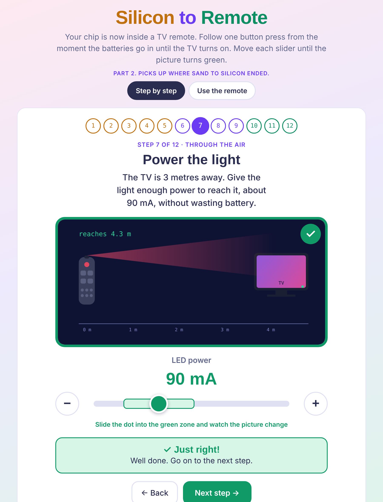
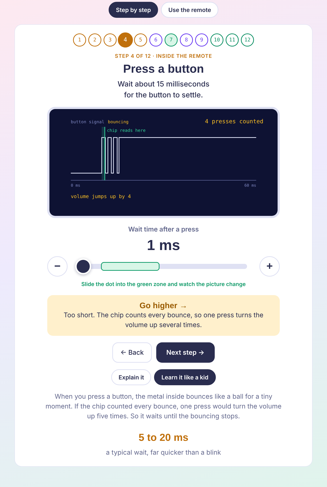
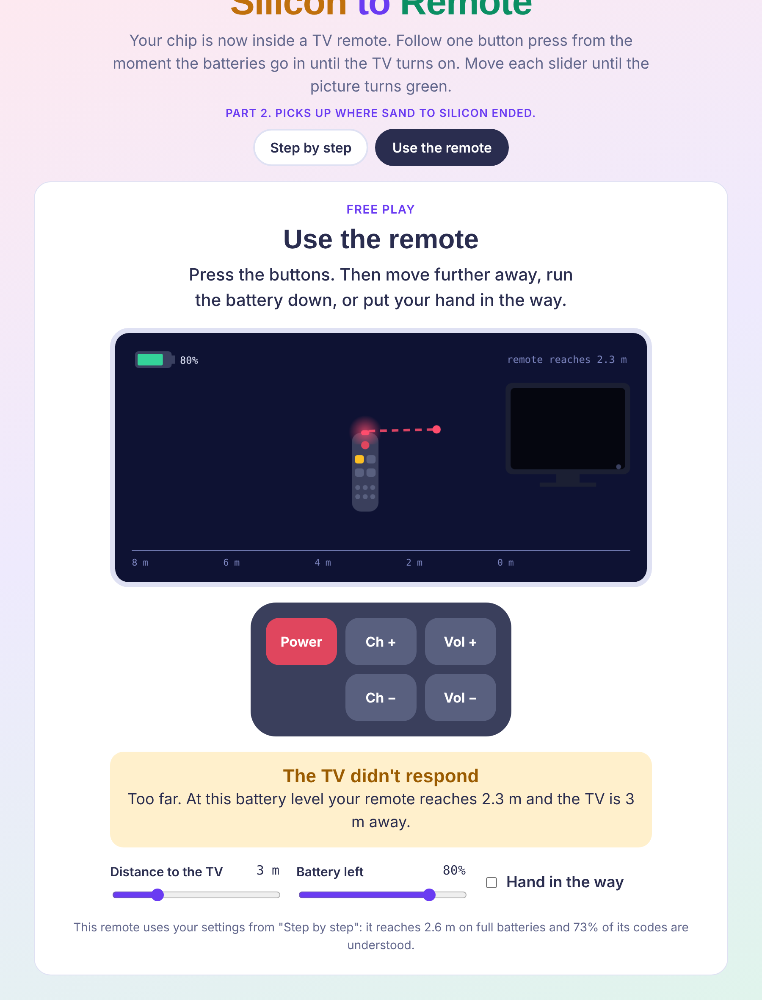

# Silicon to Remote

Part 2 of [Sand to Silicon](https://github.com/karanguptak9/simulator-learnSemiconductor). The chip you made is now inside a TV remote. Follow one button press from the moment the batteries go in until the TV turns on.

## What is in it

- **Step by step**: 12 steps in three phases.
  - Inside the remote: batteries, loading the program, sleep mode, button bounce, and turning a button into 1s and 0s.
  - Through the air: flicker speed, LED power, infrared light, and aiming.
  - Inside the TV: matching the TV's code set, checking the message, and turning the TV on.
- **Learn it like a kid**: every step can be explained for a 10-year-old.
- **Use the remote**: a working remote and TV. Change channels and volume, then move further away, run the battery down, or put your hand in the way to see why the TV stops responding. The remote behaves according to your choices in "Step by step".

## Run it

Open `index.html` in any browser. There is nothing to install. The whole simulator is that one file.

## Notes

- The results (range, battery life, presses understood) are illustrative. They are chosen to make cause and effect visible and are not measured values.
- The button codes are made-up examples. Each TV maker uses its own codes.
- Fonts load from Google Fonts when online. Offline, the page falls back to system fonts.
